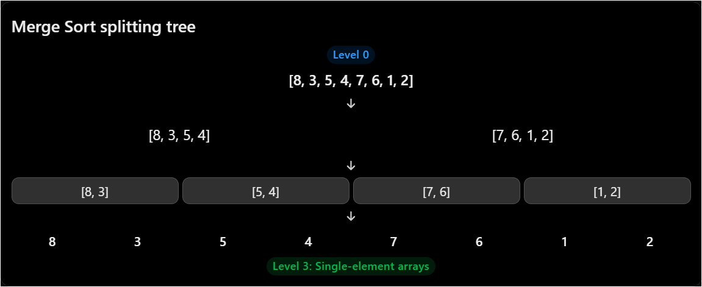

# 4. Merge Sort: Splitting

Input: `[8, 3, 5, 4, 7, 6, 1, 2]`

Merge Sort repeatedly divides the array into two halves until every subarray contains one element.

All subarrays produced:
1. `[8, 3, 5, 4, 7, 6, 1, 2]`
2. `[8, 3, 5, 4]`, `[7, 6, 1, 2]`
3. `[8, 3]`, `[5, 4]`, `[7, 6]`, `[1, 2]`
4. `[8]`, `[3]`, `[5]`, `[4]`, `[7]`, `[6]`, `[1]`, `[2]`